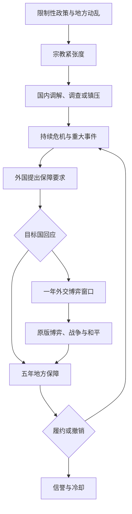

# 信仰与干涉 · DESIGN

版本：v0.1.0，2026-10-29。目标平台：Victoria 3 1.13 / 1.14。状态：实验实现，实机未验证。

## 1. 设计目标

把十九世纪的宗教问题连接到国内治理、国际干涉和战后政治。玩家可以维持传统秩序、做地方妥协、推动改革，或承担保护外国同教者的责任。宗教不同本身不产生战争资格。

首版实现一个完整闭环，而非只增加一个无条件战争借口：

## 2. 首版实际范围

| 系统 | v0.1.0 实际行为 |
| --- | --- |
| 国内危机 | 地区紧张度、固定受影响宗教、年度处置、重大事件记录 |
| 外交 | 同教与地区利益筛选、保护请求、接受/拒绝、超时清理 |
| 战争 | 一个原生外交博弈类型及一个地区型 custom 战争目标 |
| 和约 | 五年地方保障、监督成本、完成信誉、主动撤销和违约理由 |
| 保护国限制 | 一国一个承诺、一地一个保护国、三年冷却、疲劳门槛 |
| UI | 原版日志、事件、决议、外交视图；中英双语 |
| 性能 | 月度扫描国家自有地区；仅达到危机阈值且冷却结束时扫描候选国 |

尚未实现：圣地管理与朝圣、宗教自治/独立、强制改宗、专属宗教革命、利益集团领袖意识形态动态权重、单独的护教压力资源、新建筑与自定义 GUI。这些不作为已开发功能宣传。

## 3. 宗教危机产生

只在以下条件同时成立时建立地区档案：

1. 所属国采用国教或国家无神论政策，且不是分权国家。
2. 地区动乱 ≥15%。
3. 有单个人口条目规模 ≥5,000、非国教且接纳 <60 的人口。
4. 在满足条件的人口中选规模最大的条目，其宗教在该地区总占比 ≥10%。

这是一种受控的宗教冲突代理，不等于精确判断每个 Pop 的歧视原因。文化与宗教接纳相互影响；本 Mod 通过限制性宗教政策过滤，减少把一般文化矛盾误判为宗教迫害。首版不处理良心自由下的跨宗教家族摩擦。

每地固定一个受影响宗教，避免按月在教派之间跳动。若该宗教比例跌破10%，和平且无保护/和约绑定时清理档案；进行中的任务/战争保留原绑定，停止新增战争资格，避免已接受目标在战争中消失。地区易主会清理原档案。

## 4. 指标与月度数值

正式参数以 `balance.json` 为准。

| 条件 | 月度紧张度变化 |
| --- | ---: |
| 五年保障有效 | −3 |
| 否则，所属国已取消限制性政策 | −3 |
| 否则，动乱 ≥15% | +2 |
| 上述动乱分支中，受影响宗教存在规模≥5,000且生活水平<10的 Pop | 额外 +1 |
| 否则，地方恢复平静 | −2 |
| 一年调解状态有效 | 额外 −2 |
| 一年镇压状态有效 | 额外 +2 |

前三类基础分支互斥；调解与镇压修正随后叠加，最终 clamp 到0—100。改革不会瞬间清除已有镇压后果。

- **25**：允许自动国内事件；每国一年最多一次，控制弹窗密度。
- **50**：持续矛盾形成有效五年的重大事件记录，并通知政府。
- **70**：有重大事件、有效人口且无和约/地区冷却时，允许寻找保护国。
- **护教压力**：首版直接显示目标地紧张度，不维护容易漂移的第二份数值。
- **干涉疲劳**：仅本国正与绑定目标国交战时每月+2，其他情况每月−2，范围0—100；≥60阻止新任务与新升级，不删除正在进行的战争目标。

## 5. 国内选择

| 选项 | 立即效果 | 后续与代价 |
| --- | --- | --- |
| 调解 | 紧张度−15，停止已有镇压 | 一年额外−2/月；−25行政力一年 |
| 调查 | 紧张度−5 | −25行政力半年；不抹除既有事件 |
| 镇压 | 紧张度+10、重大事件记录、受影响宗教+2%激进者 | 一年额外+2/月；当地税收收集−10%、迁移吸引力−10% |

所有紧张度修改都限制在0—100。“处理国内宗教争端”决议选择未处于保障期且紧张度最高的地区，与自动事件共用一年冷却。

AI 首版国内选择权重为40/35/25；保护国接受请求权重30、拒绝70；目标国接受保障40、拒绝60。采用保守的固定权重作为可调起点，并非完善的意识形态模拟。

## 6. 谁可以成为保护国

- 存活、独立、非分权、当前和平，威望≥50。
- 国教与受影响宗教**完全相同**。
- 在目标地区所属战略区域持有利益标记。
- 不是目标国，双方当前都没有相关战争/博弈阻塞或停战。
- 目标国也是独立、和平国家，且没有待处理请求。
- 保护国没有其他承诺、没有三年冷却，疲劳<60。

候选中按威望取最高者；若无人符合，一年后重试。拒绝邀请也消耗三年保护国冷却，防止循环询问。暂不支持跨教派宗教家族保护，或针对附属国绕过宗主国干涉。

## 7. 交涉与战争

保护国接受邀请后向目标国发送五年地方保障请求。请求使用国家与地区双向绑定，不依赖仅在当前事件可用的临时 scope。

- 接受：立即停止当地镇压，开始60个月履约。
- 拒绝：保护国获得一年战争理由，可以使用原版外交视图选择“保障宗教权利”。
- 请求最长等待三个月，超过时视为拒绝；普通事件默认时限为30天。
- 未进入博弈/战争/保障的任务最多存在24个月，或在改革且紧张度低于50后结束。

战争目标：

| 字段 | 设计 |
| --- | --- |
| 名称 | 地方宗教保障 |
| 目标类型 | state，精确匹配绑定地区与原所属国 |
| 费用 | 基础5恶名、20筹码，服从引擎后续处理 |
| 控制要求 | 控制目标地区 |
| 和平效果 | 执行地方保障，不吞并、不改变全国法律、不改宗人口 |
| 升级方式 | 原版外交博弈，允许常规调停、退让、参战及谈判 |

`possible` 检查新升级资格；`valid` 只保留持有者、原目标国、地区与所属关系，不重新检查限时理由、宗教占比、紧张度、改革或疲劳。已接受目标不应因这些数值变化而被删除。

没有脚本强制宣战，也没有绕过原版停战、关系和战争限制的自定义按钮。AI 是否会主动选择并正确执行本自定义博弈，属于必须实测的引擎集成项，不承诺已验证。

## 8. 五年保障的实际含义

这是地方行政协议，**不是法律层面的全国宗教平等**。原版法律接纳数值不会被改写。

- 移除当地镇压状态与修正。
- 当地税收收集−5%，生活水平+0.5；作为地方治理与救济成本/收益。
- 每满12个月，对受影响宗教人口减少1%激进者，共五次。
- 地区紧张度基础−3/月。
- 所属国教权派认可−2，持续一年。
- 保护国持续−50外交影响力、−25行政力。
- 满60个月：停止监督成本，保护国获得+10威望修正两年，随后三年保护国冷却；地区五年新危机冷却。

奖励不是一次性累计威望；同一和约重复执行不会重置计时或重复发奖。和约到期移除临时地方修正。

保护国主动撤回或消失时，当地保障仍履行到期；该保护国不再支付成本，也不获得完成奖励。目标国可通过明确的“撤销所有地方宗教保障”决议违约：撤销修正，紧张度设为80，重新记录事件，存活保护国获得一年理由。原版停战仍然有效，所以战后违约并不一定允许立即再战。

## 9. 边界与防滥用

| 情况 | 处理 |
| --- | --- |
| 地区易主 | 原档案、地方修正与绑定清理，旧任务下次国家 pulse 失效 |
| 保护国不存在/失去任务绑定 | 地区释放预留，保障可继续 |
| 目标国不存在 | 清理保护国任务及成本，不发奖励 |
| 拒绝、撤回或失败 | 三年保护国冷却 |
| 战争期间理由到期或疲劳达到上限 | 不取消已有目标 |
| 人口信仰或国家宗教变化 | 阻止新升级，不强制改宗、不迁移战争目标 |
| 白和或失败 | 不授予保障和履约奖励 |
| 事件延迟后绑定变化 | cancellation_trigger 与效果入口再次检查 |
| 本 Mod 加入旧存档 | 月度惰性初始化；不承诺卸载安全 |

## 10. 后续版本

1. **0.2 圣地与朝圣**：少量可配置宗教地标；通行权、管理权和声望，避免用宗教凭空制造领土宣称。
2. **0.3 国内政治**：按领袖意识形态、教权派势力和实际战争收益调整压力与AI；接入原版革命与宗教运动。
3. **0.4 自治与强制政制**：以高恶名、高抵抗的独立模块提供；政府制度变化与人口信仰变化严格分离。

不在未验证引擎接口时承诺新军队种类、自动外国驻军或全新内战系统。优先完成两个版本的加载、和平执行与长局AI验证。
